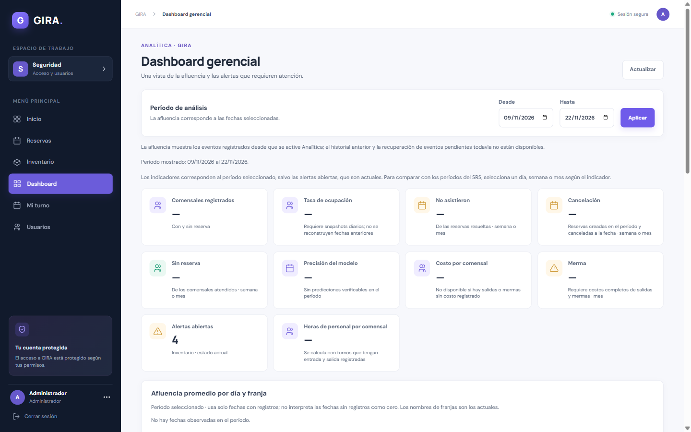
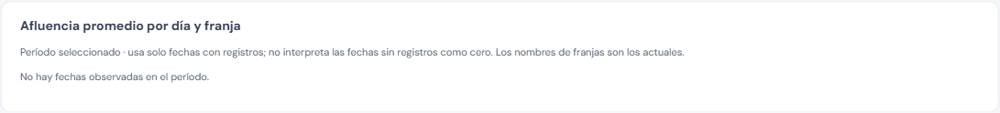
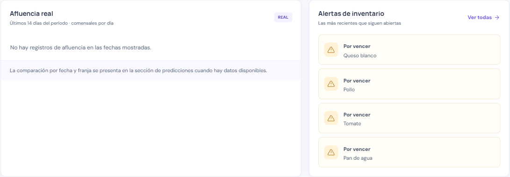
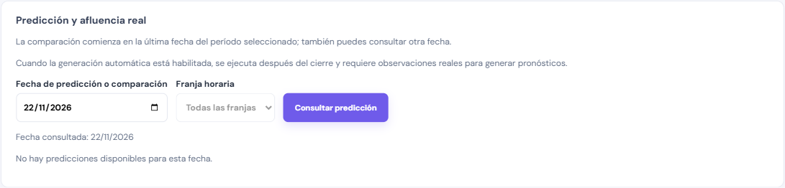
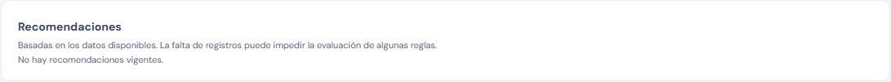
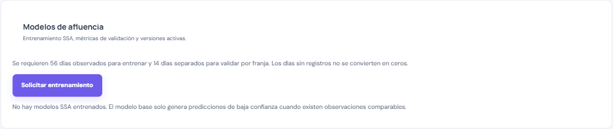
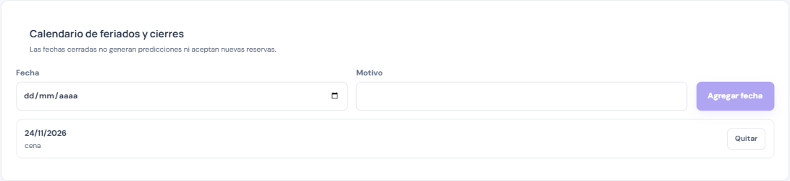

# GIRA — Informe de avances de Analítica, IA y Dashboard Gerencial

**Fecha de referencia:** 22 de noviembre de 2026.  
**Alcance:** implementación disponible en el código del repositorio; no implica
que esté desplegada en producción ni que sus integraciones estén aprobadas.

## 1. Objetivo del módulo

Analítica reúne información operativa del restaurante para que Gerencia pueda
consultar la asistencia real, comparar predicciones, revisar indicadores y
recibir recomendaciones. La predicción de afluencia utiliza un modelo de series
temporales SSA; las recomendaciones, en cambio, se generan mediante reglas
configuradas sobre los datos disponibles.

El módulo no sustituye a Reservas, Inventario, Personal ni Notificaciones:
recibe o consulta información de ellos y ofrece puntos de integración. El
alcance implementado corresponde a **un restaurante**.

Este informe sigue la organización por pantalla y funcionalidades del informe
de Reservas e Inventario. Las capturas se tomaron el 22 de noviembre de 2026
con la API y el frontend del entorno actual. Reflejan lo que mostraba ese
entorno en ese momento; no certifican que sus datos sean de operación real.

## 2. Resumen de avances

| Área | Avance implementado | Situación |
|---|---|---|
| Historial de afluencia | Registro por fecha y franja de visitas completadas y no asistencias. | Implementado; falta resolver la recuperación durable de eventos perdidos. |
| Predicción e IA | Entrenamiento SSA, validación, versiones, predicción y alternativa de baja confianza. | Implementado; generación automática apagada por defecto. |
| Indicadores | Cálculo de afluencia, ocupación, reservas, costos, alertas, precisión y horas de personal. | Implementado; depende de la disponibilidad y calidad de las fuentes. |
| Recomendaciones | Reglas de demanda, no-show, alertas recurrentes y baja confianza. | Implementadas; la entrega mediante Notificaciones está pendiente. |
| Dashboard | Consulta de indicadores, historial, predicciones, recomendaciones, modelos y cierres. | Implementado para Gerente y Administrador. |
| Integración con Inventario | El evento de predicción alimenta la proyección de consumo de Inventario. | Flujo probado; falta validación del responsable antes de habilitar la generación. |
| Integración con Personal | Se utilizan turnos cerrados para el indicador de horas por comensal; se amplió el contrato de predicción. | Marcaciones básicas implementadas; el consumidor de predicciones de Personal está pendiente de coordinación y prueba. |

## 3. Organización y elementos del dashboard

El dashboard se abre con una sesión autorizada en `/analitica/dashboard` o
`/gerencia/dashboard`. Sus secciones se presentan en una misma vista:

| Sección | Qué permite |
|---|---|
| Período de análisis | Seleccionar fechas históricas, aplicar el filtro y actualizar la información. |
| Indicadores | Consultar diez medidas de operación y sus estados de disponibilidad. |
| Afluencia promedio y real | Ver promedios por día y franja y una gráfica diaria del historial. |
| Alertas de inventario | Consultar las alertas abiertas recientes y acceder al módulo de Inventario. |
| Predicción y afluencia real | Consultar una fecha y franja y comparar la estimación con los registros reales. |
| Recomendaciones | Revisar recomendaciones vigentes, marcarlas como vistas o descartarlas. |
| Modelos de afluencia | Solicitar entrenamiento, consultar resultados y reactivar versiones anteriores. |
| Calendario de feriados y cierres | Consultar, agregar y quitar fechas cerradas. |

### 3.1 Período de análisis

**Qué muestra:** las fechas «Desde» y «Hasta», el período aplicado y el botón
para actualizar.



**Funcionalidades:**

- Permite seleccionar un intervalo histórico y aplicarlo a indicadores e
  historial; no acepta fechas futuras en ese filtro.
- Inicialmente consulta los últimos 14 días, incluido el día actual.
- Permite actualizar los datos y reintentar ante errores.
- Distingue los indicadores del período de las alertas abiertas, que reflejan
  el estado actual.

### 3.2 Tarjetas de indicadores

**Qué muestra:** tarjetas con el valor y una breve explicación de cada medida.

**Funcionalidades:**

- Presenta comensales registrados, ocupación, no-show, cancelación, proporción
  sin reserva, precisión del modelo, costo por comensal, merma, alertas abiertas
  y horas de personal por comensal.
- Si una fuente no permite un cálculo confiable, muestra el indicador como no
  disponible en lugar de inventar una cifra.
- Diferencia estados de carga y error.

Las fórmulas y fuentes se detallan en la sección 6.

### 3.3 Afluencia promedio y gráfica de afluencia real

**Qué muestra:** el promedio de comensales por día de la semana y franja, y una
gráfica de asistencia diaria de los últimos 14 días del período seleccionado.



**Funcionalidades:**

- Indica cuántas fechas observadas se utilizaron para cada promedio.
- Identifica los días sin registros; no los convierte automáticamente en cero.
- Muestra los nombres actuales de las franjas.
- Informa cuando no hay datos o no se puede consultar el historial.

### 3.4 Alertas de Inventario

**Qué muestra:** las alertas de Inventario más recientes que continúan abiertas.



**Funcionalidades:**

- Identifica el tipo de alerta y el insumo relacionado.
- Enlaza a la pantalla de Inventario para revisar todas las alertas.
- Distingue entre ausencia de alertas y un error de consulta.

El dashboard consulta las alertas existentes; no reemplaza el proceso de
atención o gestión de Inventario.

### 3.5 Predicción y afluencia real

**Qué muestra:** predicciones por fecha y franja junto con la afluencia real
cuando hay registros para comparar.



**Funcionalidades:**

- Inicializa la fecha con el final del período aplicado y permite consultar
  otra fecha entre los últimos 12 meses y los próximos 14 días.
- Permite filtrar por franja cuando existen predicciones para la fecha.
- Muestra estimación de comensales, versión del modelo, fecha de generación,
  nivel de confianza y límites del intervalo cuando están disponibles.
- Compara con la asistencia de la misma fecha y franja; indica si no hay
  registros reales.
- Presenta mensajes de carga, ausencia de datos y errores, con opción de
  reintento.

Una predicción no garantiza la asistencia futura. La generación automática
permanece desactivada hasta su validación y configuración.

### 3.6 Recomendaciones

**Qué muestra:** recomendaciones vigentes con tipo, prioridad, estado, mensaje,
fecha y origen.



**Funcionalidades:**

- Permite marcar como vista una recomendación nueva o descartarla.
- Avisa cuando no existen recomendaciones vigentes o cuando falla la consulta.
- Evalúa reglas de aumento de demanda, no-show, alertas recurrentes y baja
  confianza, siempre que las fuentes necesarias estén disponibles.

Son sugerencias para la decisión humana; no ejecutan por sí mismas compras,
cambios de personal ni otras acciones operativas.

### 3.7 Modelos de afluencia

**Qué muestra:** versiones de modelos SSA, su estado activo, métricas de
validación y resultados de entrenamientos solicitados.



**Funcionalidades:**

- Permite solicitar un entrenamiento y consultar su avance.
- Muestra resultados por franja, incluidos MAE y RMSE cuando corresponden.
- Aclara cuando faltan observaciones suficientes.
- Permite reactivar una versión anterior con un motivo; la acción queda
  auditada.

El procesador de entrenamientos está habilitado por defecto, pero los
entrenamientos se solicitan **bajo demanda**; no existe una programación diaria
de entrenamiento.

### 3.8 Calendario de feriados y cierres

**Qué muestra:** fechas cerradas próximas y, si existe, el motivo.



**Funcionalidades:**

- Permite agregar una fecha de cierre y un motivo opcional.
- Permite quitar una fecha con confirmación.
- Reutiliza los días cerrados de Configuración: en esas fechas no se aceptan
  nuevas reservas ni se generan predicciones.

## 4. Funcionamiento paso a paso

Los pasos siguientes explican el flujo funcional y técnico implementado; no
representan una cronología certificada de commits o despliegues.

1. **Configuración operativa.** El restaurante configura horarios, zonas,
   mesas, franjas y días cerrados. Esos datos sirven tanto a Reservas como a
   Analítica.
2. **Registro de actividad.** Al completarse una visita, Reservas publica un
   evento con las personas atendidas. Una reserva no asistida genera un evento
   de no-show separado. Confirmar una reserva no equivale a una visita.
3. **Historial.** Analítica procesa los eventos y guarda registros identificados
   por origen y referencia; los agrupa por fecha y franja. Un duplicado
   contradictorio se rechaza y registra.
4. **Capacidad y otras fuentes.** Antes de la apertura se captura capacidad
   diaria; Inventario aporta costos y alertas, y Personal aporta turnos cerrados.
5. **Indicadores.** La API calcula los KPI del período solicitado y devuelve
   un valor no disponible cuando faltan fuentes fiables o un denominador válido.
6. **Entrenamiento.** Un usuario autorizado solicita el entrenamiento SSA. El
   proceso valida el historial por franja, guarda métricas y decide si activa el
   modelo candidato.
7. **Predicción.** Si la generación está habilitada y configurada, el proceso
   revisa su ejecución después del cierre. Utiliza el modelo activo cuando
   corresponde o un promedio semanal de baja confianza si hay datos comparables.
8. **Publicación.** Las predicciones completas de un día se preparan como evento
   para los consumidores. Inventario utiliza las franjas para actualizar su
   proyección; la integración de Personal aún debe completarse y validarse.
9. **Recomendaciones.** Un proceso evalúa periódicamente las reglas sobre los
   datos disponibles y guarda o actualiza las sugerencias.
10. **Consulta y decisión.** Gerencia revisa el dashboard, contrasta la
    información y decide las acciones en los módulos responsables.

## 5. Integración entre módulos

| Módulo | Información o evento | Uso en Analítica y estado |
|---|---|---|
| Reservas y Visitas | `VisitaCompletadaEvent` y `ReservaNoAsistidaEvent`. | Construyen el historial de atención y no-show. Un error de Analítica se registra sin propagarse al productor ni bloquear los siguientes handlers. |
| Configuración | Horarios, franjas, zonas, mesas y días cerrados. | Se usan para capacidad, agrupación, generación y calendario. |
| Inventario | Salidas, mermas y alertas; recibe predicciones. | Aporta fuentes para KPI y recomendaciones y usa la afluencia estimada para proyectar consumo. La revisión de sus cambios de costos requiere aprobación de su responsable. |
| Personal | Turnos con entrada, salida y pausas. | Alimentan las horas por comensal; no se implementaron planificación de horarios ni nómina. La recepción de predicciones está pendiente. |
| Notificaciones | `RecomendacionGeneradaEvent` y `EntrenamientoModeloFallidoEvent`. | Son puntos de integración disponibles; todavía no prueban entrega, persistencia ni reintentos de notificaciones. |
| Seguridad | Autenticación y políticas. | Protegen el dashboard y las operaciones según el rol correspondiente. |

### 5.1 Contrato de predicciones para Inventario y Personal

El evento `PrediccionAfluenciaGeneradaEvent` conserva `Desde`, `Hasta` y la
lista `Predicciones`. Analítica emite además:

| Campo | Significado |
|---|---|
| `EventoId` | ID persistido de la publicación de un día, estable en reintentos; útil para deduplicación. |
| `VersionContrato` | Versión del contrato, actualmente `1`. |
| `RestauranteId` | GUID real del restaurante configurado en la API. |
| `OcurridoEnUtc` | Instante UTC de la generación persistida. |
| `TipoEvento` | `PrediccionAfluenciaGeneradaEvent`. |
| `PrediccionId` | ID persistido de cada predicción por fecha y franja. |
| `VersionModelo` | Versión usada para cada predicción; puede variar entre franjas. |

Los nuevos campos son opcionales en los constructores para conservar las
llamadas existentes. Los eventos antiguos pueden contener `null`: los
consumidores que requieren estos datos deben validar su presencia, versión y
restaurante. El contrato no implementa por sí solo el consumidor de Personal ni
la deduplicación de ese módulo.

La publicación se guarda para reintentos, pero el restaurante se toma de la
configuración al preparar el evento y no se persiste por publicación. Por ello,
**no debe cambiarse el ID mientras haya publicaciones pendientes**. MediatR es
un mecanismo en memoria, no una mensajería durable entre servicios.

## 6. Indicadores: fuentes y cálculo

| Indicador | Fuente y cálculo |
|---|---|
| Comensales atendidos | Personas de visitas completadas, con o sin reserva. |
| Ocupación | Comensales del período / capacidad acumulada × 100; requiere capturas diarias para todo el período. |
| No-show | Reservas no asistidas / (reservas completadas + no asistidas) × 100. |
| Cancelación | Reservas creadas en el período que están canceladas al consultar / reservas creadas en el período × 100. |
| Sin reserva | Comensales de visitas sin reserva / comensales atendidos × 100. |
| Precisión del modelo | MAE: promedio del error absoluto entre predicción previa al inicio del día local y asistencia real por fecha y franja. Menor MAE significa menor error. |
| Costo por comensal | Costo de salidas y mermas / comensales atendidos. |
| Merma | Costo de mermas / costo de salidas y mermas × 100. |
| Alertas abiertas | Conteo actual de alertas abiertas de Inventario. |
| Horas por comensal | Horas de turnos cerrados, descontadas las pausas / comensales atendidos. |

La capacidad se captura antes de la apertura: suma la capacidad de mesas activas
en zonas activas y la multiplica por las franjas activas. Un día cerrado se
captura con capacidad cero. No se reconstruyen capturas antiguas con la
configuración actual.

Los costos dependen de movimientos y lotes con costo disponible. Las entradas
pueden usar el costo del insumo si no se proporciona otro; el consumo de
perecederos se valora por lotes FEFO y costo promedio ponderado. Si faltan costos
necesarios, el indicador puede quedar no disponible. Las horas usan turnos
cerrados cuyo inicio pertenece al período, sin repartir un turno entre fechas.

## 7. IA, reglas y procesos de fondo

### 7.1 Entrenamiento y predicción

- SSA se entrena por franja con hasta 14 días de horizonte y un intervalo de
  confianza del 95 %.
- Se requieren 70 fechas observadas consecutivas: 56 para entrenamiento y 14
  para validación. Se calculan MAE y RMSE.
- El candidato se activa cuando su MAE es igual o mejor que la referencia vigente.
- Sin modelo SSA utilizable, se usa el promedio de observaciones comparables del
  mismo día de semana y franja de los últimos 28 días, con baja confianza.
- Si no hay observaciones comparables, no se inventa una predicción. Se conserva
  el historial de predicciones y se identifica la vigente.

### 7.2 Reglas de recomendaciones

Los umbrales son configurables. Con la configuración descrita en la documentación
del módulo se evalúan:

1. Demanda prevista al menos 30 % superior al promedio observado del mismo día
   y franja en los últimos 28 días.
2. No-show superior al 15 % durante los últimos siete días.
3. Más de dos alertas del mismo insumo en el mes calendario.
4. Predicciones de baja confianza.

### 7.3 Ejecución en segundo plano

| Proceso | Configuración base | Frecuencia o condición |
|---|---|---|
| Capacidad | Habilitado | Al iniciar y cada minuto; captura cuando corresponde antes de abrir. |
| Entrenamiento | Procesador habilitado | Atiende solicitudes pendientes; espera cinco segundos cuando no hay trabajo. |
| Recomendaciones | Habilitado | Al iniciar y cada cinco minutos. |
| Generación de predicciones | **Deshabilitada** | Si se habilita, revisa cada cinco minutos después del cierre y procesa publicaciones pendientes. |

La API debe permanecer en ejecución para que estos procesos funcionen.
Configuraciones del entorno pueden sobrescribir los valores base.

## 8. Arquitectura y componentes

```text
Reservas / Visitas ── eventos ──> Historial de Analítica
Configuración ── capacidad y calendario ──> Indicadores y predicción
Inventario ── costos y alertas ──> Indicadores y recomendaciones
Personal ── turnos cerrados ──> Indicadores
Historial ── entrenamiento SSA / promedio semanal ──> Predicciones
Predicciones ── evento ──> Inventario; integración con Personal pendiente
API + datos disponibles ──> Dashboard gerencial
Recomendaciones / fallo de entrenamiento ── eventos ──> Notificaciones pendiente
```

| Capa | Responsabilidad | Ubicación |
|---|---|---|
| Domain | Entidades y estado persistido de Analítica. | [Entidades](../GIRA.Domain/Entities/Analitica) |
| Application | Casos de uso, reglas, contratos y handlers. | [Servicios](../GIRA.Application/Services/Analitica), [eventos](../GIRA.Application/Events/Analitica) |
| Infrastructure | Repositorios, SQL Server, ML.NET y procesos de fondo. | [Repositorios](../GIRA.Infrastructure/Persistence/Repositories/Analitica) |
| API | Endpoints y autorización de las operaciones. | [Controladores](../GIRA.Api/Controllers/Analitica) |
| Frontend | Dashboard y componentes visuales. | [Analítica frontend](../Gira.frontend/src/analitica) |

Se incluyeron migraciones para historial, integridad, predicciones, generaciones,
recomendaciones, entrenamiento y fuentes de indicadores. Las migraciones deben
revisarse y aplicarse de forma controlada en cada entorno.

## 9. API, permisos y configuración

Las fechas de consulta son locales e inclusivas. Las operaciones requieren sesión
y la política correspondiente.

| Operación | Ruta | Acceso |
|---|---|---|
| Historial | `GET /api/analitica/historial?desde=&hasta=` | Gerente, Administrador |
| Indicadores | `GET /api/analitica/kpis?desde=&hasta=` | Gerente, Administrador |
| Predicciones | `GET /api/analitica/prediccion?desde=&hasta=&franjaId=` | Supervisor, Gerente, Administrador |
| Solicitar entrenamiento | `POST /api/analitica/modelos/entrenamientos` | Gerente, Administrador |
| Consultar entrenamiento | `GET /api/analitica/modelos/entrenamientos/{id}` | Gerente, Administrador |
| Consultar modelos | `GET /api/analitica/modelos` | Gerente, Administrador |
| Reactivar modelo | `POST /api/analitica/modelos/{modeloId}/activar` | Gerente, Administrador |
| Consultar recomendaciones | `GET /api/analitica/recomendaciones?estado=` | Gerente, Administrador |
| Cambiar recomendación | `PATCH /api/analitica/recomendaciones/{id}` | Gerente, Administrador |
| Gestionar días cerrados | `GET`, `POST /api/feriados`; `DELETE /api/feriados/{id}` | Gerente, Administrador |
| Marcaciones propias | `GET /api/personal/marcaciones/actual`; `POST /api/personal/marcaciones/entrada` y `/salida` | Usuario autenticado con política de turnos propios |

El entrenamiento devuelve `202 Accepted` y un identificador para consultar el
resultado. Se encuentran ejemplos adicionales en [GIRA.Api.http](../GIRA.Api/GIRA.Api.http).

**Antes de habilitar la generación:**

1. Validar el flujo y los efectos con Inventario y Personal.
2. Configurar `Analitica:RestauranteId` o `Analitica__RestauranteId` con el GUID
   real acordado; no se proporciona uno ficticio.
3. Habilitar `Analitica:Generacion:Habilitada` o
   `Analitica__Generacion__Habilitada`.
4. Mantener la API activa después del cierre y revisar resultados y logs.

Si la generación se habilita sin un GUID válido y no vacío, la API falla al
iniciar. Configurar credenciales y conexión fuera del repositorio según el
[README principal](../README.md).

En este equipo se autorizó una tarea programada de Windows para ejecutar
[`supervisar-api-analitica.ps1`](../scripts/supervisar-api-analitica.ps1) al
iniciar sesión: espera si el puerto 5253 ya está ocupado y, si queda libre,
intenta iniciar la API y reintenta cuando el proceso termina. El registro queda
en `%LOCALAPPDATA%\GIRA\ApiAnalitica\supervisor.log`. Esto no asegura
disponibilidad si el equipo está apagado, no se ha iniciado sesión, otro proceso
ocupa el puerto o SQL Server no está disponible. El supervisor usa la
compilación Release existente; después de cambiar el código hay que compilar
antes de reiniciar la API.

## 10. Características no funcionales y limitaciones

- **Seguridad:** acceso mediante sesión y políticas existentes; el dashboard se
  reserva a Gerente y Administrador.
- **Trazabilidad:** los modelos conservan versiones y métricas; las
  reactivaciones manuales requieren motivo y se auditan.
- **Integridad:** el historial identifica eventos por origen y referencia y
  evita duplicados; la publicación de predicciones conserva su ID en reintentos.
- **Disponibilidad de datos:** la interfaz distingue carga, errores, falta de
  datos y baja confianza. Un dato ausente no se presenta como cero.
- **Experiencia:** se contemplan escritorio, móvil, navegación por teclado y
  opciones de reintento.
- **Resiliencia limitada:** un fallo al registrar afluencia se registra sin
  afectar la operación de origen, pero puede quedar historial faltante.
  MediatR en memoria no recupera eventos perdidos tras una caída.
- **Operación:** la capacidad y los procesos de fondo dependen de que la API
  esté activa; falta validar concurrencia con varias instancias.
- **Datos históricos:** registros, capacidades, costos o marcaciones que no
  existían antes de la captura no se reconstruyen automáticamente.

## 11. Validaciones realizadas

- En la revisión del contrato y de Inventario se ejecutaron **78 pruebas .NET**
  focalizadas, todas aprobadas. Incluyen generación y metadatos de predicción,
  proyecciones por reserva, salidas por visita y movimientos de Inventario.
- En una validación anterior de Analítica se documentaron 80 pruebas .NET,
  nueve pruebas de navegador con respuestas controladas y una integración
  aislada con SQL Server y navegador. Esa evidencia no equivale a una validación
  de operación continua con datos reales.
- La última revisión focalizada no ejecutó las pruebas de integración SQL Server;
  requieren una base de pruebas dedicada y configuración segura.

La descripción, comandos y requisitos de pruebas están en la
[documentación técnica de Analítica](analitica-ia-dashboard.md) y el
[README principal](../README.md). Las pruebas de navegador del dashboard usan
Playwright como dependencia de desarrollo.

## 12. Pendientes para completar y entregar

1. Acordar con Inventario los cambios de costo y lotes, las migraciones y la
   activación de la generación de predicciones.
2. Coordinar con Personal el GUID del restaurante y el consumo del contrato de
   predicciones; validar campos, versiones, deduplicación y comportamiento de
   GI-303 antes de considerarla completada.
3. Implementar y probar el consumidor de Notificaciones, con destinatarios,
   persistencia, entrega, reintentos y monitoreo acordados.
4. Definir recuperación durable o conciliación para eventos de afluencia
   perdidos; revisar también la publicación con varias instancias.
5. Validar visitas, no-show, capacidad, costos, turnos, indicadores,
   recomendaciones y predicciones con datos operativos reales y responsables.
6. Acordar si se requiere programar entrenamientos recurrentes y cómo detectar
   recomendaciones desactualizadas o fallos de procesos.
7. Ampliar Personal según su alcance aprobado y coordinar cambios de su fuente
   de turnos con Analítica.
8. Confirmar el SRS oficial y conciliar sus criterios, el alcance de un
   restaurante y las historias de Jira con la evidencia de implementación.
9. Validar rendimiento, precisión y procedimientos de monitoreo y recuperación
   en la infraestructura y el volumen reales.

## 13. Referencias

- [Documentación técnica de Analítica, IA y dashboard](analitica-ia-dashboard.md).
- [README principal del proyecto](../README.md).
- [Contrato del evento de predicción](../GIRA.Application/Events/Analitica/PrediccionAfluenciaGeneradaEvent.cs).
- [Dashboard gerencial](../Gira.frontend/src/analitica/Dashboard.jsx).
